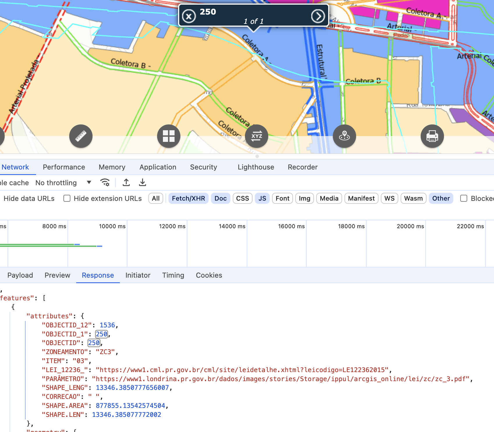
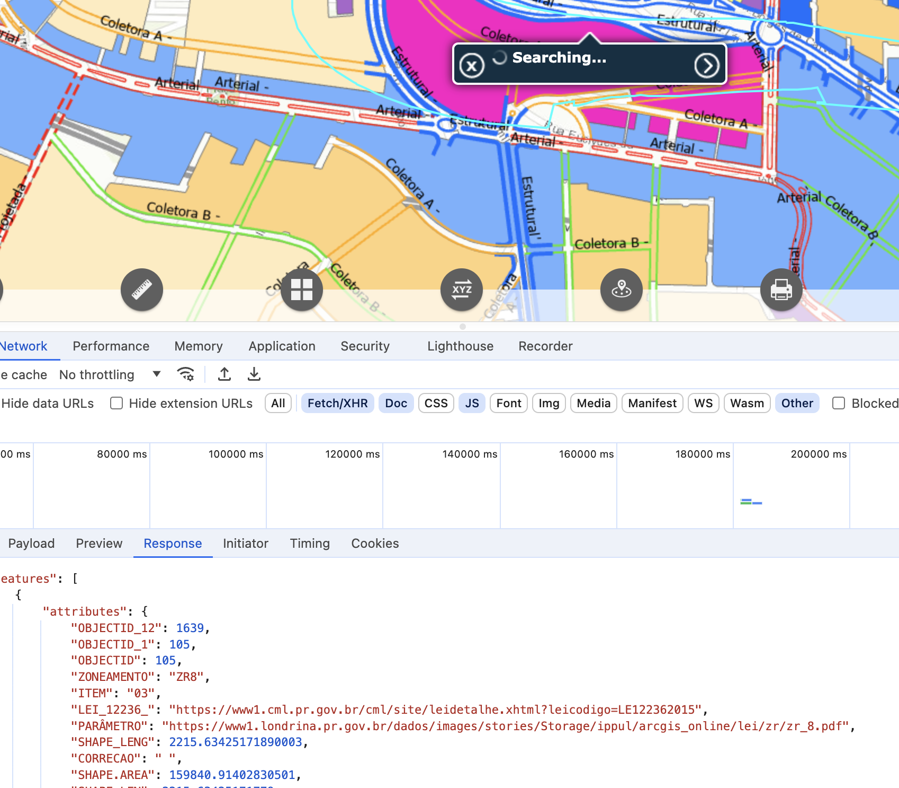
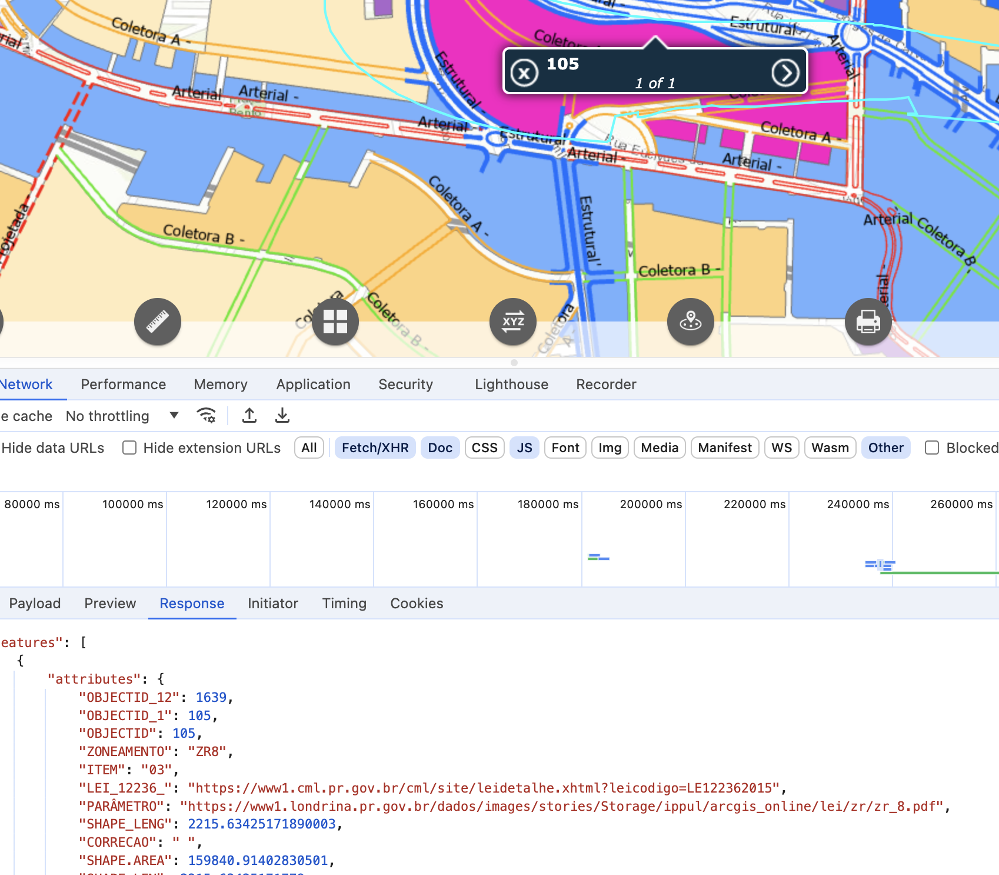
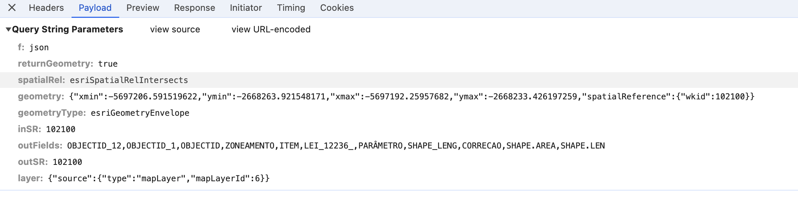
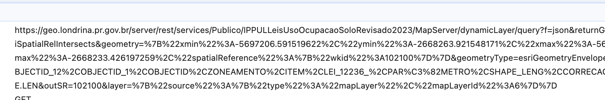
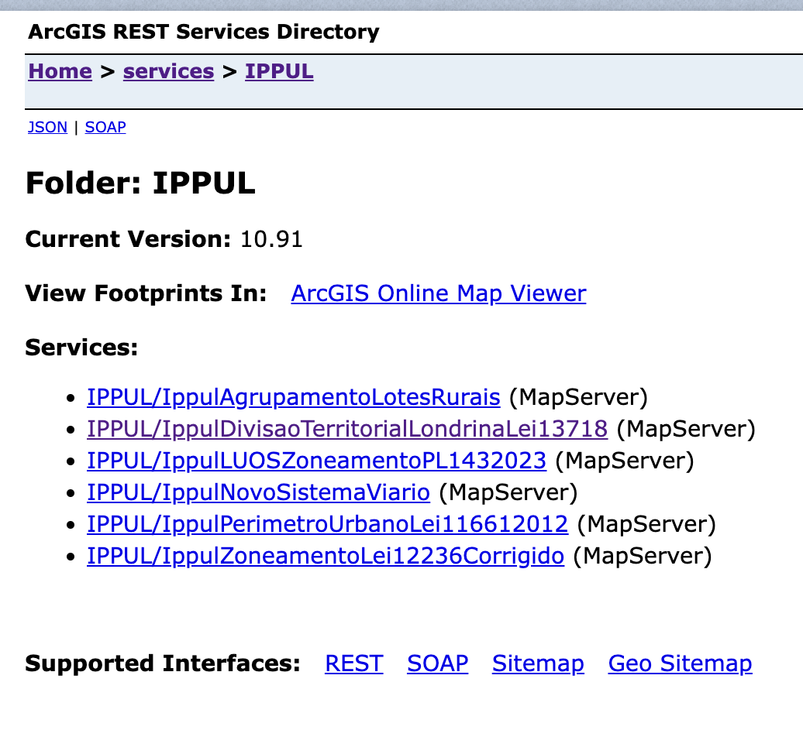
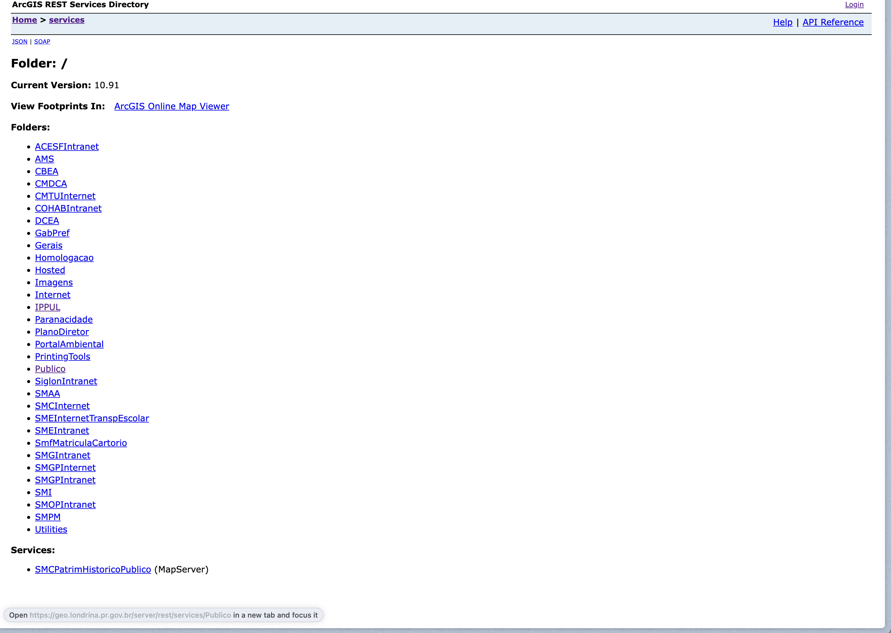
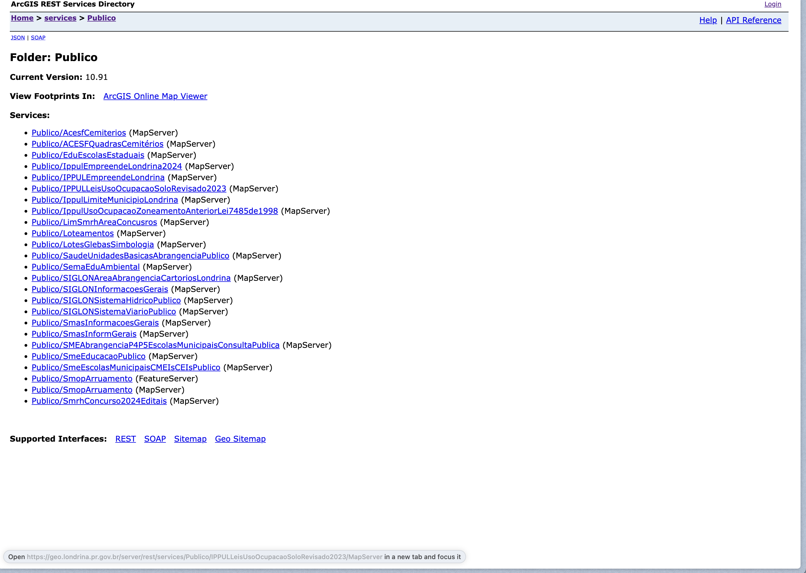

#### TODO
mostrar imagem do local?

Solução atual para consulta de zoneamento é fraca e pouco útil. Não retorna todas as informações necessárias.
O projeto consiste de criar uma plataforma simples que retorne todas as informações necessárias ao consultar um endereço.
#### Nossa solução deve:

- **Ser simples, fácil de usar:**
    Superar a solução do site "zoneamento fácil" já que ela:
     Não é responsava para mobile.
     Não retorna tudo o que deveria.
     Não é rápida o suficiente.

- **Ser estilo ChatGPT:**
    A solução atual tem interface pouco familiar. Se baseia num mapa pouco eficiente com múltiplas informações, cores e overlays na tela.
     Nossa solução deve ser como um chat capaz de receber todo tipo de endereço em qualquer formato (incluindo maps, localização, texto, número e nomes de lugares) e retornar o que é relevante.
     O usuário deve poder "perguntar" ao site, como um filtro com base em linguagem natural.
     A plataforma deve compreender e formatar como o usuário preferir retornando o que foi pedido e possivelmente sugerir algo a mais, como ChatGPT.

#### A solução atual é

- Um site para consulta:
    https://zoneamentofacil.londrina.pr.gov.br
     Ele utiliza "ArcGIS for Javascript" (https://developers.arcgis.com/javascript) para criar os maps.
     Ele utiliza uma API pública para obter os dados (https://geo.londrina.pr.gov.br/server/rest/services).
     Ele não mostra informações como recuo mas sim exige que os usuários naveguem por documentos para encontrar essas regras. (https://ippul.londrina.pr.gov.br/index.php/zoneamento-facil.html).


#### Estudo API

- A rota utilizada para obter o mapa em imagem e JSON é "https://geo.londrina.pr.gov.br/server/rest/services/Publico/IPPULLeisUsoOcupacaoSoloRevisado2023".
- A rota utilizada para obter as ruas em imagem e JSON é "https://geo.londrina.pr.gov.br/server/rest/services/Gerais/IppulHierarquiaVia/"
- A API retorna a zona dentre outras informações, incluindo links para os documentos com mais informações (Image 1).
- A API é rápida, ArcGIS que demora para mostrar as informações (Imagem 2 e 3).
- A API necessita de múltiplos parâmetros para retornar as informações (Imagem 4).
- A API não suporta informações como bairro, número ou rua no request. Apenas coordenadas. Por isso há o intermedio do mapa traduzindo essas informações para a API.
- Um request padrão feito pelo site contém como parâmetro:
	- **f**: `json`
	- **returnGeometry**: `true`
	- **spatialRel**: `esriSpatialRelIntersects`
	- **geometry**: `%7B%22xmin%22%3A-5697085.96433437%2C%22ymin%22%3A-2668401.071893647%2C%22xmax%22%3A-5697071.632391567%2C%22ymax%22%3A-2668370.576542735%2C%22spatialReference%22%3A%7B%22wkid%22%3A102100%7D%7D`
	- **geometryType**: `esriGeometryEnvelope`
	- **inSR**: `102100`
	- **outFields**: `OBJECTID%2CHIERARQUIA%2CACESSOLEI%2CCARACTERISTICAS%2CLOGRADOURO%2CCATEGORIA%2CLOCALIZACAO%2CEXTENSAO%2CALARGAMENTO1%2CPREVISAOALARGROTULO%2CSHAPE.LEN%2Chierarquia%2Cacessolei%2Ccaracteristicas%2Clogradouro%2Ccategoria%2Clocalizacao%2Cextensao%2Calargamento1%2Cprevisaoalargrotulo`
	- **outSR**: `102100`
- O parâmetro "returnGeometry" controla o retorno de parâmetros para o desenho de um contorno ou forma no mapa.
- Os parâmetros "inSR" e "outSR" representam "Input Spatial Reference" e "Output" Spatial Reference" respectivamente. Contendo nesse exemplo ambos o valor "102100", se referindo a IDs para mapeamento. Vide (https://community.esri.com/t5/arcgis-runtime-sdk-for-android-questions/wkid-102100-wkid-3857/td-p/5594)
- O parâmetro "geometry" contém um objeto JSON "url-encoded" com coordenadas estilo WKID 102100 como input para retorno de informações. Exemplo: 

```
{
  "xmin": -5697085.96433437,
  "ymin": -2668401.071893647,
  "xmax": -5697071.632391567,
  "ymax": -2668370.576542735,
  "spatialReference": {
    "wkid": 102100
  }
}
```

- Coordenadas WKID 102100 podem ser convertidas para latitude e longitude. O oposto também é válido.
- A ESRI, provedora do ArcGIS, prove bibliotecas para conversão. De qualquer forma, o algoritimo é conhecido.
- A solução atual utiliza uma API publica cuja url base é "https://geo.londrina.pr.gov.br/server/rest/services" (Imagem 5).
- Existem outras rotas não utilizadas (Imagem 6).
- Estranhamente, as rotas utilizadas pelo site não esta na categoria "IPPUL" mas sim "Publico" e utiliza uma url mau-nomeada ((https://geo.londrina.pr.gov.br/server/rest/services/Publico/IPPULLeisUsoOcupacaoSoloRevisado2023). Prática ruim e amadora por parte deles, já que uma url hardcoded incluindo o ano implica mudança arbitraria da url da API em algum momento. Assim um problema que pode surgir eventualmente é a mudança para uma nova rota 2024, 2025 ou mudança de nome completamente. Rotas deveriam ter nomeação permanente. Aparentemente não há outra rota que espelhe essa com uma url permanente.


Imagem 1 - Informações retornadas


Imagem 2 - Informação recebida mas ainda não mostrada no mapa

Imagem 3 - Após um tempo, a informação é mostrada no mapa


Imagem 4 - Parâmetros utilizados


Imagem 5 - Rota utilizada


Imagem 6 - Rota IPPUL


Imagem 7 - Rotas disponíveis


Imagem 8 - Rotas em "Publico" disponíveis